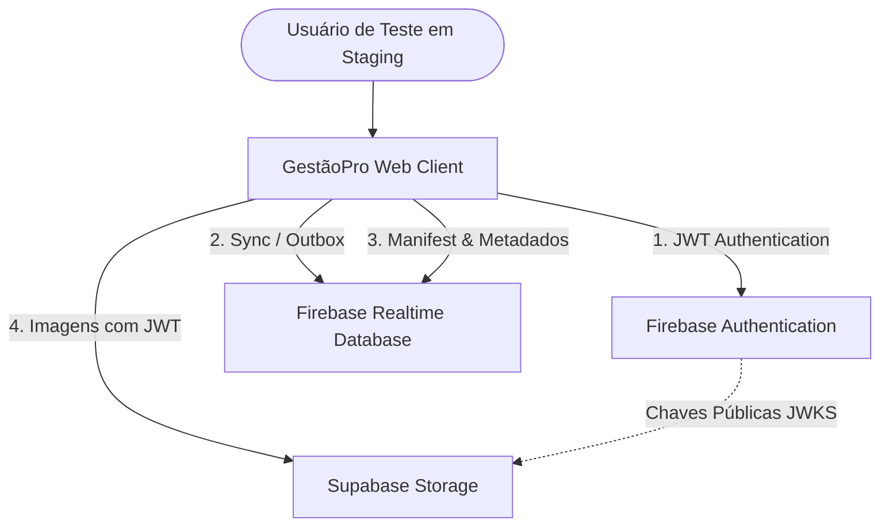
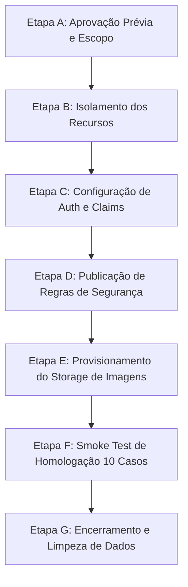

# Plano Operacional de Execução para Staging — GestãoPro (Fase 15.0)

**Documento:** `docs/FASE_15_STAGING_EXECUTION_PLAN.md`  
**Versão:** `1.13.0-rc.1`  
**Status:** PLANEJAMENTO LOCAL CONCLUÍDO — AGUARDANDO AUTORIZAÇÃO HUMANA FORMAL  
**Classificação:** `STAGING_REMOTE_EXECUTION_NOT_AUTHORIZED`  
**Data:** 13/10/2026  

---

## 1. Objetivo e Diretrizes Fundamentais

Este documento formaliza o plano operacional detalhado para a futura homologação do **Gerenciador de Produtos — GestãoPro** em um ambiente de nuvem de *staging* estritamente isolado.

### Diretrizes Inegociáveis:
1. **Ambiente Exclusivamente Dedicado:** Toda e qualquer infraestrutura utilizada para homologação deve ser nova ou dedicada (`gerenciador-produtos-staging`), sem qualquer compartilhamento de banco, regras, usuários, claims, buckets ou faturamento com projetos de produção.
2. **Proibição de Desvio para Produção:** O ambiente de produção **nunca** poderá ser utilizado para testar, contornar limitações de cota ou validar erros de homologação.
3. **Preservação de Segredos:** Nenhuma credencial real, chave de API, Service Account ou conteúdo de arquivos `.env.*` é registrado neste plano.
4. **Execução Manual com Gate de Autorização:** Nenhuma etapa deste plano deve ser disparada automaticamente. Cada fase requer verificação humana explícita antes de qualquer comando remoto.

---

## 2. Mapa Arquitetural de Componentes e Dependências

A homologação em nuvem envolve quatro subsistemas principais:



### Detalhamento por Componente:

| Componente | Serviço Responsável | Finalidade Operacional | Regras / Políticas Aplicáveis | Dependências de Configuração | Risco de Erro de Configuração |
| :--- | :--- | :--- | :--- | :--- | :--- |
| **Autenticação de Usuários** | Firebase Authentication | Login corporativo, emissão e renovação de tokens JWT com Custom Claims. | Provedor E-mail/Senha; criação pública de contas desativada. | `projectId`, `authDomain`, `apiKey` do projeto staging. | Falha de login; sessão resolvida como `viewer` se claims faltarem. |
| **Banco Transacional e Fila Outbox** | Firebase Realtime Database (RTDB) | Sincronização em tempo real de catálogo, estoque, vendas, compras e fila Outbox. | `database.rules.json` (Isolamento por `$tenantId`, ledger append-only em `/inventory`, versionamento CAS em `/products`). | `databaseURL` apontando para a instância de staging. | `permission_denied` em operações válidas (regras incorretas) ou vazamento entre tenants (regras frouxas). |
| **Mídia e Fotos de Catálogo** | Supabase Storage (ou Firebase Storage) | Armazenamento de arquivos de imagem em bucket privado `product-images`. | Políticas PostgreSQL RLS (`storage.objects`) exigindo `role = 'authenticated'` e `(appRole) IN ('admin', 'operator')`. | `supabaseUrl`, `supabaseAnonKey`, configuração Third-Party JWT no Supabase. | Upload bloqueado (erro 403 RLS) ou fotos indisponíveis para o próprio tenant. |
| **Catálogo de Mídia Offline** | Local Image Cache & RTDB Manifest | Reconciliação bidirecional do hash SHA-256 e priorização P0/P1/P2. | `/tenants/{tenantId}/imageManifest` sincronizado via RTDB. | Integrado com SyncEngine e IndexedDB local. | Dessincronia de fotos exibidas na galeria de produtos. |

---

## 3. Sequência Operacional Proposta (Etapas A até G)



### Etapa A — Aprovação Prévia
- **Objetivo:** Estabelecer a governança formal da homologação.
- **Responsáveis:** Proprietário do Produto, Líder de Arquitetura e Engenheiro Responsável.
- **Critérios de Sucesso:** Autorização formal assinada; confirmação de que os projetos de staging foram criados fora do escopo produtivo; disponibilidade dos testadores.
- **Condição de Parada:** Ausência de confirmação explícita de quem são os responsáveis ou dúvida sobre o ambiente de destino.

### Etapa B — Isolamento dos Recursos
- **Objetivo:** Garantir matematicamente e administrativamente que nenhum recurso de produção será tocado.
- **Verificações Manuais Obrigatórias no Console:**
  1. No Firebase Console: Confirmar que o Project ID é rigorosamente `gerenciador-produtos-staging` (ou projeto com prefixo `*-staging`).
  2. No Supabase Dashboard: Confirmar que o projeto é `gestaopro-staging-storage` (região São Paulo `sa-east-1`, plano Free).
  3. No repositório local: Validar que `firebaseConfigValidator.js` bloqueará a inicialização se qualquer variável contiver strings proibidas de produção (`isProductionProject === true`).
- **Condição de Parada:** Identificação de qualquer Project ID, URL de banco ou bucket compartilhado com ambiente de produção.

### Etapa C — Configuração de Autenticação e Custom Claims
- **Objetivo:** Provisionar usuários de teste com o contrato canônico estabelecido na Fase 14.
- **Contrato Canônico Obrigatório de Claims:**
  ```json
  {
    "tenantId": "tenant-staging-01",
    "appRole": "admin | operator | viewer",
    "role": "authenticated"
  }
  ```
- **Esclarecimento sobre Papéis e Conta de Auditoria:**
  O sistema suporta exclusivamente os papéis de negócio canônicos `admin`, `operator` e `viewer` (`VALID_BUSINESS_ROLES` em `FirebaseAuthProvider.js`). A conta denominada "Auditor de Teste" representa uma **função operacional de conferência fiscal/leitura**, e seu papel empresarial canônico é **estritamente `viewer`**. Não existe um papel `auditor` no schema do banco ou nas regras de segurança.
- **Usuários Fictícios de Homologação:**
  1. `admin@staging.gestaopro.internal` — Papel Comercial: `appRole: 'admin'` | Papel Técnico: `role: 'authenticated'` | Tenant: `'tenant-staging-01'` (Acesso irrestrito a catálogo, vendas, estoque, compras e fornecedores).
  2. `operador@staging.gestaopro.internal` — Papel Comercial: `appRole: 'operator'` | Papel Técnico: `role: 'authenticated'` | Tenant: `'tenant-staging-01'` (Acesso a catálogo, vendas e estoque; compras/fornecedores bloqueados).
  3. `auditor@staging.gestaopro.internal` — Função: Auditor de Teste | Papel Comercial Canônico: `appRole: 'viewer'` | Papel Técnico: `role: 'authenticated'` | Tenant: `'tenant-staging-01'` (Somente leitura autorizada de relatórios e catálogo; qualquer mutação estritamente bloqueada).
  4. `admin-b@staging.gestaopro.internal` — Papel Comercial: `appRole: 'admin'` | Papel Técnico: `role: 'authenticated'` | Tenant: `'tenant-staging-02'` (Isolamento multi-tenant: validação de bloqueio cruzado com o Tenant 01).
- **Execução:** Utilizar script administrativo externo via Firebase Admin SDK com credenciais de Service Account temporárias obtidas fora do repositório, emitindo o dicionário integral sem perda de atributos.
- **Condição de Parada:** Falha na atribuição de claims ou token retornando `appRole` ausente (o app rebaixa para `viewer`).

### Etapa D — Publicação Controlada das Regras de Segurança
- **Objetivo:** Aplicar as regras estritas auditadas localmente.
- **Ações Planejadas:**
  1. **Realtime Database:** Executar deploy de `database.rules.json` exclusivamente para o projeto `gerenciador-produtos-staging`.
  2. **Validações Remotas:**
     - Comprovar que a raiz `/tenants` rejeita leitura e escrita anônima.
     - Comprovar que `/tenants/tenant-staging-01/inventory` aceita inserções com campos válidos (`id`, `productId`, `quantity`, `delta`, `type`, etc.) e rejeita sobrescrita (`set` em nó existente) ou remoção física (`set(null)`).
- **Condição de Parada:** Erro de sintaxe na publicação de regras ou relaxamento indevido de permissões.

### Etapa E — Storage de Imagens e Políticas RLS
- **Provedor Primário Adotado:** Supabase Storage (Plano Free, sem cobrança, 1GB de cota, bucket privado).
- **Ações Planejadas:**
  1. Configurar Third-Party Auth no Supabase Dashboard com o Issuer e JWKS do Firebase Auth do projeto staging.
  2. Executar a migração SQL `supabase/migrations/20261010000000_create_product_images_storage.sql` no SQL Editor do Supabase.
  3. Confirmar que o bucket `product-images` está com `public = false`.
  4. Testar que `SELECT` e `INSERT` funcionam para o tenant correspondente e falham com 403 para tenant discordante.
- **Condição de Parada:** Falha na validação do JWT do Firebase pelo Supabase ou bucket configurado como público.

---

## 4. Bateria de Smoke Tests de Homologação (10 Casos de Teste)

| Caso | Cenário de Teste | Pré-condição | Procedimento de Execução | Resultado Esperado | Evidência Verificável | Critério de Falha |
| :---: | :--- | :--- | :--- | :--- | :--- | :--- |
| **ST-01** | Autenticação de Usuário | Conta `admin@staging...` provisionada | Efetuar login com e-mail e senha no cliente web conectado ao staging | Sessão iniciada; dados do usuário visíveis | Objeto de sessão retornado com `authenticated: true` | Erro `auth/user-not-found` ou senha rejeitada |
| **ST-02** | Validação de Claims Canônicas | Usuário autenticado | Inspecionar `getIdTokenResult()` e sessão no painel do app | Claims `tenantId`, `appRole` e `role` canônicas presentes; banner de migração ausente | `canonicalClaims: true`, `requiresMigration: false`, badge "Administrador" | Badge "Visualizador" ou alerta "Requer regularização administrativa" |
| **ST-03** | Escrita e Leitura de Produto | Sessão de Admin ativa | Criar produto de teste com ID `prod_smoke_01`, SKU, preço e estoque inicial | Produto persistido no RTDB sob `/tenants/tenant-staging-01/products` e renderizado na UI | `version: 1`, `salePriceCents` salvo e recuperado no reload | Erro `permission_denied` ou dados não persistidos |
| **ST-04** | Sincronização entre Duas Sessões | Duas abas autenticadas no `tenant-staging-01` | Editar o produto `prod_smoke_01` na Sessão A | A Sessão B recebe atualização em tempo real sem recarregar | Listener `onValue` reflete o novo preço em < 2 segundos na Sessão B | Preço antigo permanece na Sessão B até F5 |
| **ST-05** | Operação Offline e Reconexão | Sessão de Operador ativa | Desconectar Wi-Fi / modo offline; registrar venda; reconectar rede | Venda salva na Outbox local IndexedDB; escoada causalmente para o RTDB após reconexão | Outbox transita de `PENDING` $\to$ `SYNCING` $\to$ `SYNCED`; estoque deduzido | Perda da venda ou travamento em `FAILED` |
| **ST-06** | Recuperação após Perda de ACK | Outbox com envio iniciado | Simular fechamento abrupto de aba durante envio de movimentação `mov_smoke_01` | Ao reabrir app, `SyncEngine` executa leitura de reconciliação pré-despacho | Registro classificado como `RECORD_EQUIVALENT`; 0 novas gravações no RTDB | Duplicação do movimento no ledger remoto |
| **ST-07** | Integridade do Ledger Append-Only | Sessão de Admin | Criar movimento de estoque `mov_smoke_02` e tentar sobrescrever nó diretamente | Tentativa de update ou delete direto no RTDB é rejeitada pelo servidor | Servidor retorna `PERMISSION_DENIED` para `set()` de alteração | Modificação do registro histórico permitida |
| **ST-08** | Bloqueio de Acesso Cross-Tenant | Sessão A (`tenant-staging-01`) e Sessão B (`tenant-staging-02`) | Sessão B tenta ler ou escrever dados de `tenant-staging-01` | Requisição categoricamente rejeitada pelo servidor | `PERMISSION_DENIED` imediato; nenhum dado de A visível em B | Vazamento de catálogo ou registros entre tenants |
| **ST-09** | Ciclo de Vida de Foto no Storage | Sessão de Admin | Upload de foto JPEG válida (<10MB); verificar visualização; excluir foto | Upload concluído no bucket privado; thumbnail renderizada; exclusão autorizada | Status 200 no upload; Blob em cache; objeto removido do bucket | Erro 403 RLS no upload ou foto legível por outro tenant |
| **ST-10** | Logout e Troca Segura de Sessão | Sessão A ativa | Executar logout e entrar com Sessão B (outro tenant) | Sessão A totalmente revogada; IndexedDB e memória limpos; dados de A inacessíveis | Nenhuma tela ou cache de A vazando para B | Persistência indevida de dados do tenant anterior |

---

## 5. Encerramento e Limpeza Delimitada de Dados de Teste (Etapa G)

- **Escopo Estrito e Inequívoco:**
  A purga pós-homologação atinge **exclusivamente** os registros sintéticos criados para o teste, identificados pelas seguintes regras obrigatórias:
  1. **Delimitação de Tenant:** Aplica-se unicamente ao tenant descartável `tenant-staging-01`. É terminantemente proibido tocar em outros tenants (ex: `tenant-staging-02`).
  2. **Prefixos Obrigatórios:** Apenas entidades com os prefixos explícitos de teste:
     - Produtos: `prod_smoke_*`
     - Movimentações de estoque: `mov_smoke_*`
     - Vendas: `sale_smoke_*`
     - Compras: `pur_smoke_*`
     - Imagens: Arquivos armazenados no caminho `tenants/tenant-staging-01/products/prod_smoke_*/`
  3. **Proibição de Deleção Ampla:** Fica expressamente vedada qualquer chamada de deleção recursiva sobre nós raiz (`/tenants`, `/tenants/tenant-staging-01`), truncamento de tabelas ou remoção do bucket `product-images`.
- **Governança e Procedimento Operacional de Purga:**
  1. A purga requer uma **autorização operacional separada**, emitida pelo responsável após homologação de todos os casos ST-01 a ST-10.
  2. Registrar relatório de evidências com a contagem de registros antes da purga.
  3. Executar script administrativo restrito que itera exclusivamente sobre as chaves correspondentes aos prefixos de teste.
  4. Registrar relatório de evidências após a purga comprovando que o banco e o bucket permanecem estruturados e vazios de dados de teste.
  5. Limpar o IndexedDB dos navegadores de teste utilizados (`indexedDB.deleteDatabase`).
- **Condição de Parada (STOP):** Se for detectado qualquer registro com ID divergente dos prefixos de teste ou com propriedade de tenant ambígua, o script de limpeza deve ser imediatamente interrompido.

---

## 6. Matriz de Riscos, Sinais de Parada e Procedimento de Recuperação

| Risco Identificado | Severidade | Probabilidade | Sinais Observáveis | Ação de Prevenção | Condição de Parada (STOP) | Procedimento de Diagnóstico e Recuperação |
| :--- | :---: | :---: | :--- | :--- | :--- | :--- |
| **Apontamento Acidental para Produção** | **CRÍTICA** | Baixa | `projectId` sem sufixo `staging`; credenciais de produção | `firebaseConfigValidator.js` com bloqueio fail-closed ativo | **IMEDIATA:** Interromper execução ao menor sinal de drift | Verificar `.env.staging`, limpar cache do Vite, revalidar variáveis. Nunca prosseguir. |
| **Falha de Claims / Rebaixamento para Viewer** | **ALTA** | Média | Usuário admin loga como visualizador; banner de regularização ativo | Script administrativo valida retorno de `setCustomUserClaims` | Interromper testes de escrita até correção das claims | Inspecionar JWT via `getIdTokenResult()`. Reemitir `{ tenantId, appRole: 'admin', role: 'authenticated' }`. |
| **Rejeição por Regras RTDB (`database.rules.json`)** | **ALTA** | Baixa | `permission_denied` em criações legítimas de produtos ou estoque | Testes prévios locais da Fase 14.26 no emulador | Interromper teste da funcionalidade afetada | Inspecionar nó exato no Firebase Rules Simulator do Console; validar schema `$other`. |
| **Falha de Políticas RLS no Supabase Storage** | **ALTA** | Média | Upload de fotos falha com código 403 / `new row violates row-level security policy` | Execução prévia do script SQL de migração; validação de claims JWT | Pausar testes de imagens | Verificar no Supabase Dashboard se Third-Party Auth validou o emissor Google; revisar política RLS. |
| **Divergência de Ledger ou Duplicação de Movimento** | **CRÍTICA** | Baixa | Quantidade duplicada no RTDB; Outbox travando em `RECORD_DIVERGENT` | Contrato de ID estável e recuperação por leitura comprovados na Fase 14.26 | **PARAR HOMOLOGAÇÃO:** Risco de integridade financeira | Inspecionar logs da Outbox no IndexedDB; comparar `operationId` e `canonicalPayloadHash`. |
| **Vazamento Cross-Tenant** | **CRÍTICA** | Baixa | Usuário do Tenant B enxerga produtos ou estoque do Tenant A | Raiz `/tenants/$tenantId` com autorização restrita no RTDB e RLS | **PARAR IMEDIATAMENTE:** Falha de isolamento de dados | Auditar regras no console; comprovar claims do usuário; isolar bancos. |
| **Esgotamento de Cota / Throttling em Staging** | **MÉDIA** | Baixa | Erro HTTP 429 ou Storage retornando cota excedida | Cota do Supabase Free Tier monitorada; fotos compactadas em WebP (<250KB) | Pausar uploads massivos | Purgar imagens de testes anteriores; conferir volumetria no dashboard. |
