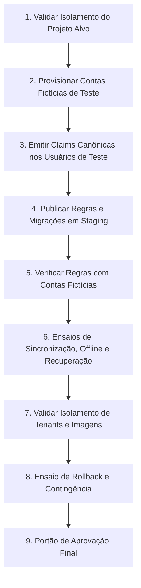

# Avaliação Local de Prontidão para Staging — GestãoPro (Fase 14.25)

## 1. Visão Geral e Objetivo
Este documento formaliza a avaliação local de prontidão (*Staging Readiness Assessment*) do projeto **Gerenciador de Produtos — GestãoPro** ao término da Fase 14.25.
O objetivo é consolidar tudo o que foi comprovado matematicamente e empiricamente no ambiente de desenvolvimento local após a validação adversarial de contratos, compatibilidade offline e recuperação segura, discriminar estritamente as pendências e riscos que só podem ser validados em um ambiente de homologação (*staging*) em nuvem, e definir um plano operacional estrito de execução, sem qualquer intervenção em infraestrutura produtiva ou remota nesta fase.

---

## 2. O que está Comprovado Localmente

Todas as afirmações abaixo são respaldadas por testes automatizados executados contra emuladores locais oficiais do Firebase (`@firebase/rules-unit-testing`, Realtime Database Emulator, Storage Emulator), emulação do IndexedDB (`fake-indexeddb`) e mocks determinísticos em memória:

1. **Regras de Segurança do Realtime Database (`database.rules.json`):**
   - Isolamento multitenant estrito na raiz `/tenants/$tenantId`.
   - Prevenção rigorosa de vazamento e escrita cross-tenant.
   - Validação de payload estrita com `$other: { ".validate": false }` em `/inventory`.
   - Imutabilidade do ledger append-only `/inventory`: rejeita `update` parcial, sobrescrita e remoção física (`!data.exists() && newData.exists()`).
   - Controle de concorrência otimista (CAS) em `/products` via versionamento monotônico incremental (`baseVersion` e `version`).
2. **Regras de Storage (`storage.rules`) e Políticas SQL Supabase Storage:**
   - Isolamento multitenant em caminhos canônicos `tenants/{tenantId}/products/{productId}/{photoId}.{ext}`.
   - Validação de integridade de metadados (Content-Type `image/jpeg`, `image/png`, `image/webp` e limite de 10MB por arquivo).
   - Políticas RLS no Supabase Storage exigindo `auth.jwt() ->> 'role' = 'authenticated'`, `auth.jwt() ->> 'tenantId' = split_part(name, '/', 2)` e `(auth.jwt() ->> 'appRole') IN ('admin', 'operator')`.
3. **Resolução Canônica de Custom Claims no Auth Emulator:**
   - Papéis empresariais legítimos (`appRole`): `'admin'`, `'operator'`, `'viewer'`.
   - Rebaixamento seguro (*fail-closed*) para `viewer` com `requiresMigration: true` em tokens com apenas claims legadas (`role: 'admin'`, `tenant_id`) ou ausência de `appRole`.
   - Desacoplamento da claim técnica de infraestrutura do Supabase (`role: 'authenticated'`), impedindo que ela conceda permissões comerciais por si só.
4. **Ciclo de Vida do Outbox e Tolerância a Quedas (Offline-First):**
   - Serialização causal FIFO por entidade (`hasUnsyncedPredecessorOrInFlight`), prevenindo inversão de ordem causal.
   - Reserva exclusiva atômica com lease temporal (`claimForDispatch`) e detecção de expiração para recuperação de instâncias travadas.
   - Preservação durável de evidências de envio (`dispatchStarted: true`) e de respostas tardias suplantadas (`staleAttemptAcks`).
   - Imutabilidade absoluta dos campos de identidade (`tenantId`, `operationId`, `entityType`, `entityId`, `canonicalPayloadHash`).
5. **Máquina de Estados Única e Recuperação do Ledger Append-Only (Fases 14.23 a 14.25):**
   - Separação entre tentativa de leitura remota (reconciliação) e tentativa de escrita comercial.
   - Consolidação pré-despacho restrita a itens estritamente pendentes, antes do despacho de rede, com recálculo consistente do `canonicalPayloadHash` e preservação do `operationId` estável.
   - Bloqueio terminante de modificação de payload comercial após `dispatchStarted: true`, `inFlight: true`, `remoteAckReceived: true` ou `requiresResolution: true`.
   - Limpeza estrita de campos de tenant no payload de ledger enviado ao RTDB para respeitar schema fechado `$other: { ".validate": false }`.
   - Leitura inacessível transitória (`INACCESSIBLE`) não é ausência: item retido em `PENDING` com `remoteOutcomeUnknown: true` e backoff exponencial (`nextReconcileAt`), proibindo retransmissão cega.
   - Escalonamento para `FAILED` com `requiresResolution: true` apenas após 5 falhas consecutivas de leitura ou erro de autorização (`PERMISSION_DENIED`).
   - Ausência autorizada (`RECORD_ABSENT`) autoriza novo envio para `CREATE`, resetando contadores e marcadores de envio anterior de forma segura.
   - Registro equivalente (`RECORD_EQUIVALENT`) conclui como `SYNCED` sem segundo movimento ou novo impacto no estoque.
   - Registro divergente (`RECORD_DIVERGENT`) bloqueia para resolução humana sem sobrescrever o servidor.
6. **Integridade do Manifesto de Imagens e Cache Local:**
   - Transacionalidade no IndexedDB entre `productImages` e `imageManifest`.
   - Deduplicação de binários baseada em hash SHA-256 e sincronização orientada a prioridades (P0/P1/P2).
7. **Compilação e Verificação Estática:**
   - Build de produção do Vite executado com 100% de sucesso (`bun run build`).
   - Verificação de caracteres e quebras de linha limpa (`git diff --check`).
   - Suíte de testes automatizados com 1.025 testes aprovados (0 falhas) em 38 arquivos.

> **Ressalva Crítica:** Ensaios locais com emuladores garantem a corretude da lógica e dos predicados de segurança, mas **não equivalem a testes de rede real em nuvem**, latência geográfica, limites de cota ou comportamento sob falhas parciais de DNS e CDN.

---

## 3. O que ainda Depende de Homologação Remota (Staging)

As seguintes validações e configurações **não foram executadas** nesta fase e exigem um ambiente de staging real em nuvem:

### 3.1. Tarefas de Configuração de Infraestrutura
- Provisionamento de um projeto isolado no Firebase e no Supabase (não produtivo e sem vínculo com faturamento/dados de clientes).
- Configuração dos identificadores de projeto (`projectId`, `authDomain`, `databaseURL`, `storageBucket`, `supabaseUrl`).
- Configuração da integração do Firebase Auth como provedor JWT de terceiros no Supabase (chave de assinatura e emissor).
- Provisionamento do bucket privado `product-images` no Supabase Storage e execução da migração SQL com RLS.
- Configuração de domínios autorizados, callbacks OAuth e CORS nas plataformas de nuvem.

### 3.2. Ensaios de Rede e Comportamento Operacional
- Latência real e desempenho de leitura/escrita com conexões remotas SSL/TLS.
- Teste de reconexão automática sob oscilação real de rede móvel (3G/4G/5G/Wi-Fi).
- Comportamento de listeners em tempo real (`onValue`, WebSockets) após suspensão e retorno de abas de navegador em dispositivos reais.
- Validação de upload de imagens reais para o bucket de homologação via URLs assinadas e tokens de curta duração.
- Verificação de quotas, *throttling*, limites de conexões simultâneas e alarmes de custo.

### 3.3. Homologação Funcional e Aprovações Humanas
- Validação do fluxo de convite e ativação de contas fictícias de teste com claims canônicas via Firebase Admin SDK em staging.
- Teste de migração simulada de contas com claims legadas (`role` -> `appRole`) em ambiente controlado.
- Ensaio de procedimento de *disaster recovery*, restauração de backup do Realtime Database e rollback de regras de segurança.
- Aprovação formal dos administradores de segurança antes de qualquer promoção para ambiente produtivo.

---

## 4. Plano Operacional de Implantação para Staging (Sem Execução)

A sequência operacional recomendada para a futura Fase de Staging deve ser rigorosa, incremental e sem risco de bloqueio de contas legítimas:

### Detalhamento das Etapas:

1. **Etapa 1 — Confirmação de Isolamento do Projeto Alvo:**
   - Validar que as credenciais e URLs de destino apontam para projetos de homologação dedicados (`*-staging` ou `*-homolog`), sem qualquer relação com projetos de produção.
2. **Etapa 2 — Preparação de Contas Fictícias de Homologação:**
   - Criar usuários de teste exclusivos (`test-admin@empresa.test`, `test-operator@empresa.test`, `test-viewer@empresa.test`) para o tenant `tenant-staging-01`.
   - Não utilizar credenciais de usuários reais.
3. **Etapa 3 — Emissão Controlada de Custom Claims Canônicas:**
   - Executar script administrativo restrito para emitir `{ tenantId: 'tenant-staging-01', appRole: 'admin', role: 'authenticated' }`.
   - Confirmar recepção das claims via `getIdTokenResult()`.
4. **Etapa 4 — Publicação Controlada das Regras de Segurança:**
   - Publicar `database.rules.json` e executar migração SQL do Supabase Storage no projeto de staging.
5. **Etapa 5 — Verificação de Regras com Contas de Teste:**
   - Comprovar que o usuário de teste realiza leituras e escritas autorizadas.
   - Comprovar que tentativas de leitura/escrita cross-tenant são bloqueadas pelo servidor.
6. **Etapa 6 — Ensaios de Sincronização, Modo Offline e Recuperação:**
   - Simular preenchimento da Outbox com dispositivo offline e verificar o escoamento causal pós-conexão.
   - Forçar interrupção de aba durante envio e confirmar que a máquina de estados unificada recupera a transação sem duplicar movimentos no ledger.
7. **Etapa 7 — Verificação de Isolamento Multitenant e Armazenamento de Imagens:**
   - Realizar upload de imagens de catálogo e validar o isolamento por tenant no bucket remoto.
8. **Etapa 8 — Validação da Estratégia de Rollback:**
   - Ensaiar a reversão de regras e restauração de dados para garantir plano de contingência caso ocorra falha.
9. **Etapa 9 — Portão de Decisão e Aprovação Humana:**
   - Emissão de relatório de homologação de staging com evidências de auditoria para deliberação final.

---

## 5. Conclusão da Avaliação de Prontidão
O código, a arquitetura de persistência, os repositórios locais, os emuladores e as especificações de regras encontram-se **100% prontos e validados localmente**. Não restam divergências pendentes no tratamento de falhas ou claims. A transição para a elaboração e execução do plano de homologação em nuvem pode ser autorizada assim que o ambiente de nuvem for formalmente aprovado.
