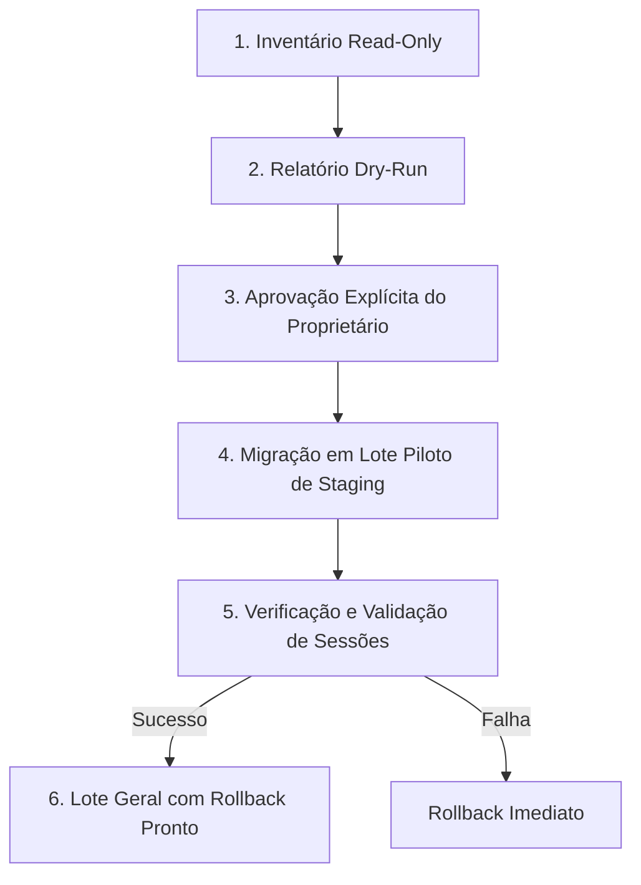

# Plano de Transição Confiável de Claims — Firebase Auth & Supabase Storage (PHASE 14.6)

**Projeto:** Gerenciador de Produtos (GestãoPro)  
**Status:** AUDITADO / PRONTO PARA TRANSIÇÃO ADMINISTRATIVA FUTURA (NENHUMA CLAIM REAL ALTERADA)  
**Data:** 10/10/2026  
**Classificação de Execução:** `CLAIMS_REAL_MIGRATION_NOT_RUN`  
**Referência Arquitetural:** [`docs/SUPABASE_STORAGE_ADR.md`](file:///c:/Users/Usu/Documents/Gerenciador%20De%20Produtos/docs/SUPABASE_STORAGE_ADR.md)

---

## 1. Objetivo e Diretrizes de Segurança

Este documento estabelece o plano formal, auditável e reversível para a futura migração das custom claims de usuários no Firebase Authentication, preparando-os para operar harmoniosamente com o Supabase Storage (Third-Party Auth / JWT) e com as regras de segurança canônicas do Firebase Realtime Database e Firebase Storage.

### Distinções Fundamentais (Fase 14.6):
* **Auditoria Local vs Inventário Remoto:** O código local foi 100% auditado e harmonizado. O inventário administrativo dos usuários reais na nuvem **ainda não foi executado** e depende de procedimento autorizado fora desta fase.
* **Claims Canônicas Exigidas Localmente:** O código da aplicação, RTDB e Storage já exige `appRole: 'admin' | 'operator' | 'viewer'`, `role: 'authenticated'` e `tenantId`.
* **Claims Reais Atuais:** O estado atual das custom claims dos usuários existentes na nuvem **permanece desconhecido** até a execução do inventário via Firebase Admin SDK.
* **Risco Crítico de Publicação Prematura:** A publicação das regras restritivas do RTDB e Storage **antes** da migração das claims dos usuários existentes revogará imediatamente o acesso de escrita de qualquer conta legada, forçando-a ao modo somente leitura (`viewer`). A migração deve anteceder estritamente o deploy das regras na nuvem.

### Diretrizes Inegociáveis
1. **Nenhuma Alteração em Usuários Reais na Fase 14.6:** Este plano é estritamente documental e auditado localmente. Nenhum usuário da nuvem foi tocado, nenhuma Service Account foi adicionada ao repositório e nenhum script de mutação remota foi executado.
2. **Substituição Total no Firebase Admin SDK:** A chamada `admin.auth().setCustomUserClaims(uid, claims)` substitui **integralmente** o dicionário de custom claims existente. Portanto, qualquer script administrativo futuro deve obter as claims vigentes, validar seus atributos, mesclar as novas claims e nunca escrever objetos parciais cegamente, preservando todas as claims não relacionadas.
3. **Fail-Closed e Cutover Canônico (Fase 14.6):** O fallback legado que concedia privilégios a tokens com `appRole == null && role == 'admin'` foi totalmente eliminado no RTDB, no Firebase Storage e na aplicação. Tokens sem claim canônica `appRole` válida (`admin` ou `operator`) são tratados estritamente como `viewer` (somente leitura autorizada onde cabível, sem escrita protegida). A interface exibe aviso claro de que a conta aguarda regularização administrativa.
4. **Isolamento Multi-Tenant:** A claim `tenantId` é inviolável e deve coincidir estritamente com o tenant do usuário.

---

## 2. Contrato de Migração: Mapeamento de Formatos

### 2.1. Formato Legado (Antes da Migração)
```json
{
  "role": "admin",
  "tenantId": "tenant-antigo"
}
```
* **Comportamento Atual (Fase 14.5):** Na aplicação cliente e no backend (RTDB e Storage), este token é resolvido estritamente como `viewer`. No Supabase Storage, o motor Postgres RLS também rejeita a requisição pois `auth.role()` não é `'authenticated'` e `appRole` é nulo.

### 2.2. Formato Canônico Alvo (Após a Migração)
```json
{
  "role": "authenticated",
  "appRole": "admin",
  "tenantId": "tenant-antigo"
}
```
* **`role`:** Definido como `'authenticated'` para satisfazer o contexto técnico do Supabase.
* **`appRole`:** Recebe o papel de negócio legítimo (`'admin'`, `'operator'` ou `'viewer'`).
* **`tenantId`:** Preservado integralmente a partir da claim existente.
* **Demais custom claims:** Quaisquer claims adicionais legítimas (ex: `featureFlags`, `branchId`) são preservadas integralmente.

---

## 3. Matriz de Mapeamento e Regras de Higienização

| Claim Legada `role` | Claim Legada `appRole` | Ação de Migração | `role` Resultante | `appRole` Resultante | Impacto no Cutover (Fase 14.5) | Justificativa |
| :--- | :--- | :--- | :--- | :--- | :--- | :--- |
| `'admin'` | *(ausente)* | Mapear para canônico | `'authenticated'` | `'admin'` | Restrito a `viewer` até migração | Promoção de papel técnico e concessão canônica do papel de negócio. |
| `'operator'` | *(ausente)* | Mapear para canônico | `'authenticated'` | `'operator'` | Restrito a `viewer` até migração | Preservação das permissões operacionais de catálogo e vendas. |
| `'viewer'` | *(ausente)* | Mapear para canônico | `'authenticated'` | `'viewer'` | Mantém `viewer` | Regularização do papel técnico Supabase. |
| *(ausente)* | `'admin'` | Regularizar `role` | `'authenticated'` | `'admin'` | Já possui escrita no RTDB/Storage | Inclusão do papel técnico do Supabase. |
| *(ausente)* | `'operator'` | Regularizar `role` | `'authenticated'` | `'operator'` | Já possui escrita no RTDB/Storage | Inclusão do papel técnico do Supabase. |
| *(ausente)* | *(ausente)* | **NÃO MIGRAR** | *(não alterar)* | *(não alterar)* | Sem permissões | Usuário sem claims não deve ser alterado sem definição explícita. |
| `'admin'` / `'operator'` | `null` *(malformado)* | **QUARANTENA / REVISÃO** | *(não alterar)* | *(não alterar)* | Restrito a `viewer` | Claim presente com valor null é ambígua. Requer auditoria manual. |
| `'admin'` / `'operator'` | `""` *(vazio)* | **QUARANTENA / REVISÃO** | *(não alterar)* | *(não alterar)* | Restrito a `viewer` | String vazia não é papel válido. Requer intervenção manual. |
| `'admin'` | `'superadmin'` *(conflito)* | **QUARANTENA / REJEITAR** | *(não alterar)* | *(não alterar)* | Restrito a `viewer` | Conflito crítico: appRole inválido não pode herdar privilégio por fallback. |
| `'operator'` | *(inválido)* | **QUARANTENA / REJEITAR** | *(não alterar)* | *(não alterar)* | Restrito a `viewer` | Conflito crítico: appRole desconhecido impede fallback. |
| `'superadmin'` *(desconhecido)* | *(qualquer)* | **QUARANTENA / REJEITAR** | *(não alterar)* | *(não alterar)* | Restrito a `viewer` | Papéis fora do domínio (`VALID_BUSINESS_ROLES`) são rejeitados. |
| `'admin'` | `'viewer'` *(conflito)* | **QUARANTENA / REJEITAR** | *(não alterar)* | *(não alterar)* | Restrito a `viewer` | Ambiguidade de segurança resolvida como fail-closed. |

---

## 4. Estratégia de Execução em Lotes (Fases Futuras)

A futura migração deverá seguir um processo estritamente controlado em 5 etapas:



### Etapa 1: Inventário Read-Only
* Listar usuários do projeto alvo via `admin.auth().listUsers(100)`.
* Extrair `uid`, email sanitizado (ex: `o***@loja.com`) e `customClaims`.
* Não realizar nenhuma gravação ou alteração.

### Etapa 2: Simulação Dry-Run
* O script deve executar em modo `--dry-run` por padrão.
* Gerar relatório estruturado com:
  - Total de usuários analisados;
  - Total de usuários já conformes;
  - Total de usuários elegíveis para migração;
  - Total de usuários em quarentena (papel inválido, conflito ou tenant ausente).

### Etapa 3: Lote Piloto (Staging)
* Executar mutações inicialmente em um subconjunto de contas de homologação sintéticas (ex: 2 a 5 usuários de teste).
* Testar login real, emissão de JWT, gravação no RTDB e upload no Storage.

### Etapa 4: Renovação Controlada de Tokens
* Como o Firebase Auth armazena tokens no cliente por até 1 hora, os usuários migrados manterão claims antigas até a renovação.
* Em ambiente de homologação, forçar `user.getIdToken(true)` no cliente ou revogar tokens via `admin.auth().revokeRefreshTokens(uid)` para exigir emissão imediata do novo JWT.

### Etapa 5: Rollback Documentado
* Antes de aplicar alterações em cada usuário, o script deve gravar um backup criptográfico/local das claims originais (`rollback_snapshot_<timestamp>.json`).
* Em caso de qualquer anomalia, o procedimento de reversão restaura o snapshot exato:
  ```javascript
  // Restauração das claims legadas
  await admin.auth().setCustomUserClaims(uid, snapshot[uid].previousClaims);
  ```

---

## 5. Especificação Técnica do Futuro Script Administrativo

Qualquer script futuro a ser criado em fase posterior deverá obrigatoriamente cumprir os seguintes requisitos de engenharia:

1. **Parâmetro Obrigatório de Projeto:**
   - O script deve exigir o `--project-id` explicitamente na linha de comando.
   - Bloquear categoricamente projetos da lista de produção (`FORBIDDEN_PRODUCTION_PROJECTS`).
2. **Dry-Run Obrigatório por Padrão:**
   - Apenas o argumento `--execute --confirm-migration` deve permitir gravação real.
3. **Preservação de Claims Legítimas:**
   ```javascript
   const currentClaims = user.customClaims || {};
   const newClaims = {
     ...currentClaims,
     role: 'authenticated',
     appRole: resolvedBusinessRole,
     tenantId: currentClaims.tenantId
   };
   ```
4. **Sem Vazamento de PII:**
   - Logs devem mascarar emails e suprimir senhas, tokens e chaves privadas.
5. **Auditoria Local:**
   - Salvar registro de execução com hash SHA-256 do snapshot para auditoria.

---

## 6. Declaração de Estado das Fases Anteriores

* **Migração de Claims Reais:** `CLAIMS_REAL_MIGRATION_NOT_RUN` (Não executada).
* **Usuários do Firebase Cloud:** 100% Intactos e Inalterados (nenhum usuário alterado, deletado ou lido na nuvem).
* **Ambiente Local e Código da Aplicação:** 100% Auditado e Coerente com o Modelo Canônico — RTDB, Firebase Storage, Supabase Storage Provider e camada de apresentação (App UI) operam com exigência de `appRole`. Usuários sem claims canônicas são apresentados e tratados como `viewer` com alerta explícito de regularização administrativa.

---

## 7. Fase 14.7 — Auditoria e Proteção de Operações Offline e Outbox

Na **Fase 14.7**, as garantias de segurança baseadas em claims canônicas foram estendidas integralmente para o funcionamento offline e persistência local:

1. **Bloqueio de Criação Local por Usuários `viewer` e `requiresMigration: true`:**
   - Serviços de domínio (`ProductService`, `StockService`, `SaleService`, `PurchaseService`, `SupplierService`) validam o papel antes de qualquer alteração de estado no IndexedDB ou ledger.
   - Contas sem claims canônicas válidas são bloqueadas em qualquer operação protegida de escrita, impedindo que mutações ilegítimas sejam persistidas localmente ou entrem na fila de sincronização.
2. **Ciclo de Vida e Resiliência da Outbox:**
   - Mutações legítimas são associadas ao `tenantId` da sessão ativa ao entrar na fila `syncQueue`.
   - Se o papel da conta sofrer downgrade ou expiração enquanto houver mutações na fila, a operação não é despachada nem descartada: é marcada como `FAILED` com `permanentFailure: true` (evitando loop infinito de retentativa).
   - Após a regularização administrativa das claims (migração canônica), a função `syncRepository.retryFailed()` permite recuperar e reenviar de forma controlada todos os itens represados.
3. **Isolamento de Tenants no Armazenamento Local:**
   - Separação estrita de IndexedDB (`BaseRepository`), filas Outbox (`SyncRepository`) e cache de fotos/manifestos (`LocalImageCache`, `ImageManifestRepository`) por `tenantId`.
   - Dados locais do Tenant A permanecem inacessíveis para o Tenant B mesmo quando ambos compartilham o mesmo navegador e dispositivo.
4. **Delimitação de Escopo de Testes:**
   - Todas as comprovações foram executadas exclusivamente com infraestrutura local (IndexedDB em memória via `fake-indexeddb`, emuladores locais do Firebase e mocks determinísticos).
   - Nenhuma conexão externa, publicação de regras ou mutação remota de claims ocorreu.

---

## 8. Fase 14.8 — Compatibilidade de Dados Legados IndexedDB, Atribuição Conservadora de Tenant e Segurança da Outbox

Na **Fase 14.8**, foi estabelecida uma política conservadora e não-destrutiva de compatibilidade para registros criados em versões anteriores do IndexedDB (v1, v2, v3):

1. **Versões de Esquema Cobertas:**
   - **v1:** Estruturas base de produtos, vendas, compras, movimentações de estoque e fila `syncQueue` original sem campo `tenantId`.
   - **v2:** Adição de `productImages` com `productId` e binários.
   - **v3:** Introdução de `imageManifest` com campos `photoId`, `productId`, `storageProvider`, `storagePath`.
2. **Preservação e Não-Atribuição Automática de Dados Legados:**
   - Registros legados sem `tenantId` **nunca** são atribuídos automaticamente à sessão do primeiro usuário logado.
   - O `BaseRepository` e repositórios derivados filtram estritamente por `record.tenantId === currentTenant`. Registros sem tenant ou com outro tenant permanecem invisíveis para a sessão ativa e protegidos contra mutações/exclusões acidentais.
   - Registros ambíguos são classificados como `tenantStatus: 'PENDING_ATTRIBUTION'`. Permanecem 100% preservados no banco local, sem exposição cross-tenant e sem envio para a nuvem.
3. **Atribuição Segura com Comprovação Inequívoca:**
   - O serviço `LegacyDataMigrationService` permite auditar (`auditLegacyData`) e migrar apenas registros cuja relação de proveniência seja comprovadamente inequívoca:
     - Manifestos de imagens correlacionados com produtos já atribuídos confiavelmente ao mesmo tenant.
     - Filhos relacionais vinculados a pais comprovadamente identificados.
     - Mapeamentos verificados por reconciliação administrativa.
4. **Tratamento da Outbox Legada e Política de `retryFailed()`:**
   - Operações pendentes legadas na `syncQueue` sem `tenantId` ou marcadas com `requiresResolution: true` são bloqueadas pelo `SyncEngine` contra despacho remoto para evitar corrupção na nuvem.
   - A reativação de operações com falha via `retryFailed()` segue uma política restritiva:
     - **Falhas Transitórias (Elegíveis):** Falhas de rede (`NETWORK_ERROR`), indisponibilidade de serviço (`TIMEOUT`, `HTTP 503`) são retentadas após validação de pertencimento ao tenant atual e de autorização do papel.
     - **Falhas Permanentes / Bloqueadas (Não Retentadas Automaticamente):** Negações de permissão (`PERMISSION_DENIED`), erros de validação de payload/schema, itens de outro tenant ou itens legados sem tenant requerem intervenção manual (`requiresResolution: true`).
     - A promoção de papel ou login de outro usuário **não** causa reenvio automático de operações marcadas como falhas permanentes.
5. **Proteção contra Troca de Tenant Durante o Despacho (In-Flight):**
   - O `SyncEngine.processQueue` valida a identidade e o tenant antes de cada requisição remota e após a resposta da nuvem, abortando o ciclo imediatamente se a sessão mudar no meio do despacho assíncrono.
6. **Procedimento de Regularização e Recuperação:**
   - Registros locais legados retidos como `PENDING_ATTRIBUTION` podem ser auditados via `LegacyDataMigrationService.auditLegacyData()`.
   - Após validação administrativa, uma migração supervisionada pode associá-los ao tenant legítimo chamando `LegacyDataMigrationService.migrateUnequivocalRecords()`.

---

## 9. Fase 14.9 — Fronteira de Confiança de Tenant e Reconciliação Transacional de Dados Legados

A **Fase 14.9** introduziu garantias formais contra auto-atribuições cegas ou falsas declarações de origem:

1. **Fronteira de Confiança (`AttributionTrustBoundary.js`):**
   - Strings descritivas fornecidas por chamadores (ex.: `'ADMIN_RECONCILIATION_VERIFIED'`) **não são aceitas como prova**.
   - Toda atribuição requer evidência estruturada de proveniência (`RELATIONAL_PROVENANCE`, `IMAGE_MANIFEST_PROVENANCE`) ou plano assinado de reconciliação humana (`HUMAN_RECONCILIATION`).
   - Reconciliações humanas exigem `confirmedByHuman === true`, operador identificado (`confirmedByUserId`), justificativa fundamentada e sessão ativa com papel `admin`.
2. **Atomicidade e Transações Multi-Store:**
   - A reconciliação opera sob transações multi-store atômicas no IndexedDB, atualizando produtos e propagando para `imageManifest`, `productImages`, `stockMovements`, `sales` e `purchases` de forma tudo-ou-nada.
   - Preservação estrita de chaves primárias, histórico contábil do ledger, valores financeiros e hashes de fotos.
3. **Recuperação de Interrupções em Voo na Outbox:**
   - Se uma mutação foi aceita remotamente mas a sessão mudou antes da marcação local, a fila retém `remoteAckReceived: true` e a finaliza como `SYNCED` no retorno da sessão original, sem disparar nova requisição de rede.
   - Mutações cujo resultado remoto seja desconhecido (`remoteOutcomeUnknown`) em coleções de ledger append-only têm retry automático bloqueado para prevenir quebra de regras de imutabilidade ou duplicação de saldo de estoque.

---

## 10. Fase 14.10 — Autoridade de Reconciliação Humana e Garantias de Idempotência

1. **Autoridade Efetiva Exigida para Planos de Reconciliação:**
   - O método `executeHumanReconciliationPlan()` exige autenticação ativa obtida da autoridade canônica (`AuthService`), validando `appRole === 'admin'`, `requiresMigration === false` e identidade do operador correspondente ao `confirmedByUserId`.
   - Operadores com papel `operator`, `viewer` ou tokens legados sem migração são categoricamente bloqueados de autorizar ou executar planos de reconciliação de dados.
2. **Reconciliação Auditável da Outbox:**
   - Operações retidas na fila por causa original `unassigned_legacy` são regularizadas para `PENDING` apenas se o plano de reconciliação humana comprovar atribuição do registro correlato para o mesmo tenant.
   - Operações com resultado remoto desconhecido no ledger ou falhas permanentes permanecem bloqueadas contra qualquer reativação automática.
3. **Persistência de ACK e Crash Recovery:**
   - Ao reiniciar, o `SyncEngine.recoverInterruptedInFlight()` inspeciona operações que estavam em voo durante falhas de execução.
   - Mutações com confirmação remota comprovada (`remoteAckReceived: true`) são finalizadas com sucesso local sem retrabalho na nuvem.
   - Mutações sem confirmação confirmada são isoladas como resultado remoto desconhecido, impedindo reenvios cegos sobre coleções append-only do Realtime Database.

---

## 11. Fase 14.11 — Contrato de Identidade de Operação, Idempotência e Reconciliação Remota

1. **Matriz de Operações e Estabilidade de Identidade:**
   - **Produtos, Vendas e Compras:** Utilizam identificadores estáveis (`entityId`), gerados uma única vez na camada de negócio e persistidos antes do envio. Em caso de retry ou recuperação de interrupção, o motor compara a representação canônica dos campos de negócio (`arePayloadsEquivalent`). Se equivalente, reconhece o sucesso remoto sem re-despacho; se divergente, bloqueia por conflito (`payload_divergence_conflict`).
   - **Ledger Append-Only (`stockMovements` / `inventory`):** Identificador estável obrigatório (`movementId`). Proibido gerar novo UUID para contornar rejeições. Em caso de resultado remoto desconhecido, retries cegos são proibidos para evitar duplicação do saldo físico de estoque.
   - **Operações Compostas:** Vendas e compras que produzem movimentações de estoque geram itens separados na Outbox com IDs estáveis e referências cruzadas (`referenceId`, `referenceType`). A recuperação trata cada efeito de forma independente.
2. **Diferenciação Estrita de Identificadores e Estados de Confirmação:**
   - **`entityId`:** Chave primária estável e durável do registro no banco local e na nuvem.
   - **ID da Operação Lógica:** Identificador conceitual da ação comercial.
   - **ID do Item da Outbox:** Identificador único da entrada na fila local (`syncQueue.id`), transmitido como `lastMutationId` para o protocolo anti-loop.
   - **ACK Recebido vs. Persistido:** ACK recebido é transitório na rede; ACK persistido (`remoteAckReceived: true`) é gravado em disco antes de finalizar `SYNCED`, permitindo finalização pós-crash sem tráfego de rede.
   - **Resultado Remoto Desconhecido:** Falha durante voo sem confirmação do destino; impede repetição cega em operações de ledger.
3. **Controle de Força e Reconciliação Manual:**
   - `options.force: true` exige papel administrativo (`admin`), não permite contornar regras do backend, não gera novos IDs e exige ação explícita de resolução em casos de divergência de payload.
   - Fornecidos métodos `inspectOutboxItem()` e `reconcileOutboxItem()` com persistência durável do histórico da decisão (`reconciledByAdminUid`, `reconciliationDecision`, `reconciledAt`).

---

## 12. Fase 14.13 — Imposição de Invariantes no Servidor e Controle de Escrita Direta por Papel

Na **Fase 14.13**, as regras do Realtime Database foram reforçadas para impor restrições que independem da boa conduta do código cliente:

1. **Restrições de Exclusão Física por Papel (`products`):**
   - Usuários com `appRole: 'operator'` têm permissão de gravação e atualização em produtos, mas a exclusão física (`!newData.exists()`) é **terminantemente bloqueada no servidor**.
   - Operadores só podem executar **exclusão lógica** (soft delete via preenchimento de `deletedAt`).
   - Apenas usuários com `appRole: 'admin'` detêm permissão para efetuar exclusão física direta de produtos no banco.
2. **Imutabilidade e Não-Exclusão de Registros Financeiros (`sales` e `purchases`):**
   - A regra de escrita exige obrigatoriamente `newData.exists()`, proibindo exclusão física tanto para `admin` quanto para `operator`.
   - Campos comerciais fundamentais (`quantity`, `totalSaleCents`, `unitSalePriceCents`, `unitCostCents`, `productId`, `date` em vendas; `totalAmountCents`, `productId`, `quantity`, `supplierId`, `date` em compras) são estritamente imutáveis no servidor em qualquer operação de update.
   - Cancelamento é restrito a campos acessórios (`cancelledAt`, `cancelReason`, `notes`, `updatedAt`).
3. **Resistência das Regras a Clientes com Claims Válidas:**
   - Possuir claims válidas de `admin` ou `operator` e `tenantId` correto não confere poder de violar o contrato de concorrência.
   - O servidor RTDB rejeita chamadas diretas de SDK (`set`, `update`) que tentem pular versões, omitir `baseVersion`, reverter versões ou sobrescrever o ledger `/inventory`.
4. **Alinhamento do Plano de Migração de Claims:**
   - Permanece em vigor o princípio fail-closed: contas sem custom claims canônicas continuam caindo em `viewer` e tendo qualquer escrita rejeitada pelo servidor.
   - O plano administrativo de provisionamento via Firebase Admin SDK continua como etapa prévia necessária para homologação completa na nuvem.

---

## 13. Fase 14.14 — Contrato Fim-a-Fim de Versionamento, Bootstrap Legado e Integridade de `baseVersion`

1. **Validação das Regras com Custom Claims Canônicas:**
   - As regras de versionamento estrito (criação em `version: 1`, incremento CAS `version === currentVersion + 1`, `baseVersion === currentVersion`, inteiros `% 1 === 0`) foram testadas e validadas sob tokens portando custom claims canônicas (`tenantId`, `role: authenticated`, `appRole: admin/operator`).
   - Usuários com papéis insuficientes ou claims legadas sem migração são bloqueados imediatamente no nível da regra `.write` antes mesmo da avaliação das expressões de `.validate`.
2. **Ciclo de Vida de `baseVersion` no Pipeline de Sincronização:**
   - `baseVersion` opera como metadado de sincronização otimista e proteção anti-concorrência.
   - A normalização em `operationIdentity.js` e a paridade de provedores (`FirebaseRealtimeProvider` e `MockRealtimeProvider`) asseguram que o metadado não degrade a computação de hashes SHA-256 canônicos nem crie falsas rejeições em retentativas idempotentes.
3. **Salvaguarda de Registros Legados Não-Migrados:**
   - Registros legados no Realtime Database que ainda não possuem o atributo `version` só aceitam bootstrap determinístico (`baseVersion: 1, version: 2` ou `version: 1`).
   - Mutações arbitrárias, saltos de versão ou tentativas de sobrescrita sem `baseVersion` são estritamente rejeitadas, prevenindo que clientes contornem as garantias de concorrência.

---

## 14. Fase 14.15 — Fechamento das Brechas de Versionamento, CAS e Proteção contra Escritas Diretas

1. **Eliminação de Vias de Escape de Versionamento no Servidor:**
   - A regra em `/tenants/$tenantId/products/$productId` foi blindada contra a ausência de `version`.
   - O campo `version` é obrigatório em todas as escritas (`newData.hasChildren(['id', 'name', 'salePriceCents', 'version'])`).
   - Tentativas de nulificação (`update({ version: null })`, `update({ baseVersion: null })`), escrita de objeto completo sem `version` ou atualizações multipath fraudulentas são rejeitadas categoricamente pelo RTDB.
2. **Contrato Estrito de Versionamento:**
   - **Criação:** Exige estritamente `version: 1` e `baseVersion` ausente ou `0`. Rejeita versões negativas, nulas, decimais ou maiores que 1.
   - **Atualização:** Exige estritamente `baseVersion === currentVersion` e `version === currentVersion + 1`, ambos inteiros (`% 1 === 0`).
   - Imutabilidade absoluta do identificador do produto e do `tenantId`.
3. **Proteção Rigorosa de Registros Legados e Migração Administrativa:**
   - Clientes comuns estão impedidos de realizar mutações comerciais ou bootstraps genéricos sobre produtos legados não-versionados (`!data.hasChild('version')`).
   - Leitura de registros legados é mantida com isolamento por tenant.
   - A migração oficial de registros legados para inclusão de `version` é mantida como pré-requisito da Fase 15 via Firebase Admin SDK.
4. **Proteção contra Exclusão Física em Nível `.write`:**
   - Exclusão física de produtos por operadores via `remove()` ou `set(null)` é terminantemente bloqueada pelas regras `.write`.
   - Vendas e compras possuem bloqueio total de exclusão física para todos os papéis (`newData.exists()`).
   - `/inventory` permanece append-only estrito, sem edição ou deleção.
5. **Isolamento de Ambiente e Ausência de Ações em Produção:**
   - Todas as validações foram realizadas no Firebase RTDB Emulator local.
   - Nenhuma conta real, projeto em nuvem ou claim remota foi alterada.

---

## 15. Fase 14.21 — Auditoria Final de Identidade Canônica, ACKs Atrasados e Segurança das Transições do Outbox

1. **Convenção Canônica Unificada de Custom Claims:**
   - Apenas os nomes `tenantId` e `appRole` são canônicos para controle de acesso multitenant e comercial (`role: 'authenticated'` é o papel técnico JWT do Supabase).
   - Nomes em formato snake_case como `tenant_id` ou `role: 'admin'` pertencem estritamente a formatos legados.
   - Não existe fallback silencioso de `appRole` para `role`, nem de `tenantId` para `tenant_id`. Contas sem claims canônicas são tratadas como `viewer` (`requiresMigration: true`).
2. **Segurança de ACKs Atrasados e Titularidade de Despacho:**
   - Quando uma tentativa antiga de envio recebe uma resposta remota tardia após outra instância ter assumido o despacho (`superseded: true`), o evento é gravado na coleção isolada de evidências `staleAttemptAcks`.
   - Um ACK atrasado **nunca sobrescreve o estado da tentativa atual**, **nunca remove `requiresResolution`** e **nunca altera uma operação de `FAILED` para `SYNCED`**.
   - A evidência durável de que o servidor aceitou a mutação (`remoteAckReceived: true`) é preservada sem corromper a ordenação ou os bloqueios locais.
3. **Isolamento por Tenant dos Métodos de Recuperação do SyncRepository:**
   - O método `findById` do Outbox aplica isolamento por tenant da sessão ativa por padrão.
   - Rotinas internas de recuperação do `SyncEngine` utilizam consultas técnicas explícitas (`allowCrossTenant: true` ou `findTechnicalRecord`).
   - O método `update` impõe imutabilidade estrita de identidade (`tenantId`, `operationId`, `entityType`, `entityId`).
   - Uma sessão ativa de um tenant está terminantemente proibida de alterar o payload comercial de itens pertencentes a outro tenant.
4. **Distinção Estrita entre Ausência Remota e Falhas de Leitura:**
   - Erros de rede, timeouts e desconexões são classificados como `INACCESSIBLE` (`isAbsent: false`, `requiresResolution: true`), preservando a operação para retry com backoff.
   - Falhas de autorização são classificadas como `PERMISSION_DENIED` (`isAbsent: false`, `requiresResolution: true`), bloqueando retentativas cegas.
   - Apenas respostas autorizadas com snapshot explicitamente vazio (`null`) são tratadas como ausência.
5. **Matriz Específica por Entidade e Ação:**
   - `CREATE`: Ausente permite novo despacho; equivalente conclui como `SYNCED` idempotente; divergente bloqueia colisão de ID.
   - `UPDATE`: Ausente bloqueia como `UPDATE_ON_ABSENT_RECORD` (`requiresResolution: true`); nunca recria o registro silenciosamente; divergente bloqueia por conflito CAS.
   - `DELETE`: Ausente conclui como `ALREADY_DELETED` (`SYNCED`); presente valida exclusão pendente.
   - Ledger Append-Only (`stockMovements`/`inventory`): Ausente permite despacho seguro; equivalente conclui sem duplicar; divergente bloqueia colisão; resultado incerto ou falha de leitura trava com `requiresResolution: true`.
6. **Limitações de Atomicidade e Fronteiras Distribuídas:**
   - O `LocalImageCache` garante atomicidade transacional local entre `productImages` e `imageManifest` via `executeTransaction(['productImages', 'imageManifest'])`.
   - A persistência remota em nuvem (upload de binário no Storage e gravação de metadados no RTDB) consiste em passos de rede distribuídos orquestrados pela Outbox. Em caso de queda intermediária, a reconciliação é garantida por idempotência de hash SHA-256 e verificação de leases.

---

## 16. Fase 14.22 — Fechamento das Invariantes de ACK, Ledger Append-Only e Custom Claims antes do Plano de Staging

1. **Contrato Canônico Estrito (`tenantId` e `appRole`):**
   - O contrato oficial de autorização multitenant e comercial do GestãoPro baseia-se unicamente nas claims `tenantId` (string não-vazia obrigatória) e `appRole` (`'admin'`, `'operator'`, `'viewer'`). A claim técnica de infraestrutura JWT para o Supabase Storage é `role: 'authenticated'`.
   - Nomes legados como `tenant_id` ou `role: 'admin'`/`'operator'` são estritamente históricos e mantidos exclusivamente para testes negativos de compatibilidade. Não há equivalência nem herança de privilégios.
2. **Política das Contas Legadas e Estado `requiresMigration`:**
   - Contas que não portam `appRole` válido ou que possuem apenas atributos legados são interpretadas em modo *fail-closed* como `viewer`, com flag `requiresMigration: true`.
   - Essas contas mantêm leitura autorizada do tenant, mas são categoricamente barradas de qualquer escrita no Realtime Database, no Storage e no IndexedDB local.
3. **Distinção entre ACK da Tentativa e Confirmação Atual da Operação:**
   - O recebimento de uma confirmação de rede por uma tentativa antiga cuja concessão expirou (`superseded: true`) é registrado duravelmente como evidência técnica em `staleAttemptAcks` e marca `remoteAckReceived: true`.
   - Esse marcador **nunca substitui a titularidade da tentativa atual**, **nunca apaga `requiresResolution`**, **nunca remove bloqueios por conflito/divergência** e **não é suficiente por si só para transicionar o item para `SYNCED`**.
4. **Política de Retentativa do Ledger Append-Only (`/inventory`):**
   - A coleção `/inventory` é estritamente append-only. Mutações com envio iniciado (`dispatchStarted: true`) ou resultado remoto incerto (`remoteOutcomeUnknown: true`) são proibidas de retentativa cega via `processQueue()`.
   - A retentativa só ocorre após reconciliação prévia autorizada: se o nó remoto estiver ausente (`RECORD_ABSENT`), o reenvio único é liberado; se for equivalente, conclui-se como `SYNCED`; se divergente ou inacessível por falha de leitura (`INACCESSIBLE`/timeout/`PERMISSION_DENIED`), o item permanece bloqueado com `requiresResolution: true`.
5. **Condições para Marcar um Item como `SYNCED`:**
   - Um item da Outbox só transiciona para `SYNCED` quando: (a) a tentativa titular atual recebe confirmação remota válida dentro do seu lease; ou (b) uma leitura remota autorizada comprova registro remoto equivalente ao payload canônico (`canonicalPayloadHash`); ou (c) um ACK legítimo tardio é reconciliado sem conflito pendente e com estado remoto confirmado.
6. **Condições que Exigem Resolução Manual (`requiresResolution: true`):**
   - Conflitos de versão (`VERSION_CONFLICT`), divergência de payload (`RECORD_DIVERGENT`), tentativa de UPDATE sobre registro inexistente (`UPDATE_ON_ABSENT_RECORD`), falhas de autorização de leitura (`PERMISSION_DENIED`) e ledger append-only com status incerto ou timeout persistente exigem intervenção humana supervisionada.
7. **Separação entre Recuperação Técnica e Autorização Comercial:**
   - Métodos técnicos do `SyncRepository` (`findTechnicalRecord`, `isTechnicalUpdate: true`) destinam-se exclusivamente ao motor `SyncEngine` para gerenciar metadados de ciclo de vida (leases, contadores, timestamps).
   - Campos de identidade canônica (`tenantId`, `operationId`, `entityType`, `entityId`, `canonicalPayloadHash`) são **absolutamente imutáveis**.
   - A troca de sessão impede qualquer leitura comercial ou mutação de dados entre tenants distintos.
8. **Limitações da Consistência entre IndexedDB e Sistemas Remotos:**
   - O ambiente opera sob o modelo de consistência eventual *offline-first*.
   - Não existem transações distribuídas globais de duas fases (*2PC*) entre o IndexedDB local e os backends de nuvem. A integridade apoia-se em transações atômicas locais por repositório, idempotência criptográfica via hashes canônicos e contratos CAS monotonicamente crescentes no servidor.
   - **Salvaguarda Operacional:** Nenhuma claim real foi alterada em nuvem, e nenhum provisionamento administrativo de staging foi executado nesta fase.

---

## 17. Fase 14.23 — Consistência Final da Recuperação do Ledger, Semântica de Claims e Prontidão para Staging

1. **Eliminação da Divergência Documental/Funcional no Ledger (`/inventory`):**
   - A divergência entre bloqueio imediato e repetição indefinida foi resolvida através de uma máquina de estados única e determinística:
     - Leitura remota transitória inacessível (`INACCESSIBLE`) **não é ausência** e **não autoriza reenvio da escrita**. O item é mantido em `status: 'PENDING'`, com `remoteOutcomeUnknown: true`, `requiresResolution: false`, e agenda retentativas de leitura com backoff exponencial via `nextReconcileAt`.
     - Ao esgotar 5 tentativas de leitura, escala para `status: 'FAILED'`, `requiresResolution: true` e `permanentFailure: true`.
     - Erro de segurança de leitura (`PERMISSION_DENIED`) bloqueia imediatamente com `requiresResolution: true`.
     - Leitura autorizada que comprove ausência (`RECORD_ABSENT` / `null`) autoriza novo envio exclusivo para `CREATE`.
     - Registro remoto equivalente (`RECORD_EQUIVALENT`) conclui como `SYNCED` sem nova escrita e sem duplicação de saldo.
     - Registro remoto divergente (`RECORD_DIVERGENT`) bloqueia com `requiresResolution: true`.
2. **Harmonização das Claims (`tenantId`, `appRole`, e claim técnica `role: 'authenticated'`):**
   - `tenantId`: Tenant empresarial autorizado (obrigatório).
   - `appRole`: Papel comercial legítimo (`'admin'`, `'operator'`, `'viewer'`).
   - `role: 'authenticated'`: Claim técnica do JWT exigida pelo Supabase / PostgreSQL. Não concede papel empresarial nem autorização comercial de escrita.
   - Proibido qualquer fallback automático de `role` para `appRole` ou de `tenant_id` para `tenantId`.
3. **Salvaguarda Operacional:**
   - Nenhum deploy, acesso à nuvem real, emissão de claims em produção ou migração administrativa foi realizada. Validações 100% locais no ambiente de desenvolvimento/emulador.

